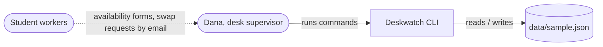
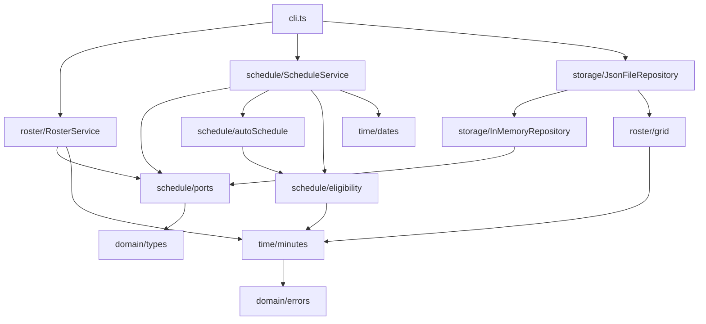

# Deskwatch architecture

Handover notes from the first developer. Read this before the code.

## Context

Deskwatch schedules one help desk, one week at a time. Dana, the desk supervisor, is the
only person who runs it; she enters availability from the forms the student workers hand
in, builds the week, adjusts it, and resolves swap requests the workers send her. The
workers themselves never touch the system. It is a command-line tool over one JSON file
and that is deliberate: the previous process was a spreadsheet and a pile of email, and the
goal was to get the rules out of Dana's head into code that can be tested.

Out of scope, on purpose: more than one desk; weeks that depend on each other (every week
is built from the standing availability, not from last week); payroll, time clocks, or
anything that records what actually happened; a web interface; multiple users.

## Components

- `domain/types.ts`, `domain/errors.ts`: the entities (plain readonly objects) and the one
  `DomainError` class. Every rule violation is a `DomainError` with a `code`.
- `time/minutes.ts`: 'HH:MM' to minutes and back, plus `overlaps` and `contains` on spans.
  All time arithmetic goes through here. `time/dates.ts` validates `weekOf` (a Monday).
- `roster/grid.ts`: the standing grid, 25 shifts. `roster/RosterService.ts`: workers and
  their availability windows.
- `schedule/eligibility.ts`: `canWork(worker, shift, assignments, shifts)` returns a verdict
  with a reason. This is R1 to R3 in one place.
- `schedule/autoSchedule.ts`: pure function, R4. Takes workers and shifts, returns
  assignments and the list of open shifts.
- `schedule/ScheduleService.ts`: build, assign, unassign, swaps, and the two reports.
- `schedule/ports.ts`: the `Repository` interface and the `IdSource` type. Services take
  both in the constructor; tests use the in-memory repository and a counter.
- `storage/`: `InMemoryRepository` and `JsonFileRepository` (which wraps the in-memory one
  and rewrites the whole file after every change).
- `cli.ts`: argv parsing and text tables. No rules live here.

## Key rules

- R1 A worker can only be assigned to a shift that lies entirely inside one of their availability windows.
- R2 A worker is never assigned two shifts that overlap in time; adjacent shifts are fine.
- R3 A worker's assigned hours in a week never exceed `maxHoursPerWeek`.
- R4 Auto-scheduling fills shifts in grid order (Mon 08:00 first) and gives each shift to the eligible worker with the fewest hours assigned so far, breaking ties by fewest total availability hours and then by name; a shift that cannot be filled is left open and reported.
- R5 A manual assignment follows R1 to R3 too; `--force` overrides R1 only and is recorded with source `manual`.
- R6 A swap moves one assignment from one worker to another; it is valid only if the receiving worker satisfies R1 to R3 for that shift, and on acceptance the old assignment is removed and the new one recorded with source `swap`.
- R7 The coverage report lists, for each shift, required staff against assigned staff and marks a shift open when it is under.
- R8 The fairness report lists hours per worker against their cap and the standard deviation of utilisation (hours divided by cap) across workers.
- R9 Times are minutes since midnight internally; 'HH:MM' strings exist only at the edges (input parsing, JSON, output).

## Decisions

- [ADR 0001: weeks are independent and rebuilt from standing availability](docs/adr/0001-weeks-are-independent.md)

## Known limitations

- The selection rule in `autoSchedule.ts` (R4) is hard-coded. A `SelectionStrategy`
  interface was sketched so that "preferred shifts" or seniority could change the pick
  without touching the loop, but it was never written; the loop calls `pickBest` directly.
- `ScheduleService.acceptSwap` re-implements the availability and overlap checks inline
  instead of calling `eligibility.canWork`. It was written before `eligibility.ts` was
  extracted and never moved over, so the two copies can drift.
- There is no way to take a single day off. Availability is the standing weekly pattern;
  to skip one Wednesday you have to edit the window and put it back afterwards.
- `cli.ts` parses `08:00-12:00` ranges with its own regex before handing the strings to
  `minutes.ts`, which parses them again. Two parsers, two sets of error messages.
- The JSON file format is only documented by `domain/types.ts`. Nothing explains the three
  `source` values or what a `declined` swap means for the schedule.
- Reports are plain text on stdout. Dana currently pastes the grid into an email by hand.

## Where to start reading

1. `src/domain/types.ts`, five minutes.
2. `src/schedule/eligibility.ts`, then `src/schedule/autoSchedule.ts` and
   `tests/autoSchedule.test.ts` side by side.
3. `src/schedule/ScheduleService.ts`, skimming `acceptSwap` last (see above).
4. `src/cli.ts` only when you need to add or change a command.
